# Authority, Roll Lifecycle, Visibility & the Event Log (CoC 7e Tracker Backend)

## Overview

Docs 10–21 lean on a layer none of them ever specifies: something must decide *who* may write
a field, *how* a roll requested by one person and executed by another moves through time,
*what* each viewer is allowed to see, and *what* the durable record is. Six of those docs
independently invoke an "append-only event log" without defining one. This doc specifies the
layer. Core positions: (1) authority is **role + campaign policy + a thin per-actor ownership
grant**, with field-level authority carried as static rules-engine metadata rather than
per-document ACLs; (2) a check is a **persisted state machine with a mutable post-resolution
window that must be explicitly frozen** — half of 7e's rules run after the dice land, and the
experience-tick gate (doc 12) literally cannot be evaluated until the aggregate closes; (3)
visibility is a **server-side projection per viewer**, closed over the derived-value
dependency graph — leaking `san.max` leaks Cthulhu Mythos, and leaking `maxHp` leaks the
major-wound threshold; (4) the log is canonical, current state is a materialized projection,
and a specific short list of facts (`majorWound`, the per-instance damage split, the Mythos
clamp vs. real SAN loss, `tickSourceRollId`, dice faces) is **unrecoverable from later
state** and must be written into events at the moment it is true.

---

## 1. Role & permission model

### 1.1 Principals

| Principal | Scope | Notes |
|---|---|---|
| `KEEPER` | campaign owner | Implicit OWNER on every document in the campaign. Sole holder of destructive/config rights. |
| `CO_KEEPER` | campaign | Everything except campaign deletion, rules-policy edits, member management, and content-pack visibility changes. Mirrors Foundry's *Assistant* role. |
| `PLAYER` | campaign | Owns 1..n investigators. Zero authority outside owned actors + own user prefs. |
| `SPECTATOR` | campaign | Read-only, restricted to the `public` visibility class. Never a roll subject or a roll author. |
| `ENGINE` | system | Pseudo-principal for auto-applied rules. Must appear in the log as an author (§5). |

Membership is `(campaignId, userId, role)` — roles are **campaign-scoped, never global**. The
same user Keeps one campaign and plays in another; nothing about identity is global.

### 1.2 Prior art

| System | Model | What to take |
|---|---|---|
| Foundry VTT | Global user *role* (None/Player/Trusted/Assistant/Gamemaster) × per-document *ownership* (`INHERIT -1`, `NONE 0`, `LIMITED 1`, `OBSERVER 2`, `OWNER 3`), keyed by user id with a `default` key. GMs own everything; documents stay GM-only until ownership is granted. | The four-level ladder, the `default` fallback key, and the "unset means Keeper-only" default. LIMITED is *system-defined* — CoC7 renders it as portrait-and-name-only for NPCs (v0.6.8). |
| Foundry CoC7 | Roll visibility checked against the **subject actor's ownership**, not the acting user's role (v8.1). Opposed rolls: "if the target is a PC, only GM can see the initiator roll" (v0.3.4). | Derive a roll's audience from its subject actor, never its requester. |
| Roll20 | Per-journal-entry lists: "can be edited & controlled by" vs "in player's journal" (view). Token control follows the linked character. | View and control as separate grants; control derived from ownership, not an independent flag. |
| Alchemy RPG | Per-NPC "public description" toggle; players mark their own backstory public/private (GM always sees it). | Per-field reveal toggles on NPCs, plus the asymmetry that the Keeper sees player-private data and never vice versa. |
| Fantasy Grounds | Host/client split with per-record "visible to client" flags and explicit shared-record push. | Sharing as an act producing a record, not an ambient state. |

### 1.3 Decision: role + policy, with a narrow ACL

**Three resolution layers**, evaluated in order; each may only narrow:

1. **Role ceiling** — what the role could ever do in this campaign.
2. **Document grant** (the thin ACL) — `ActorGrant(actorId, userId|'default', level ∈
   NONE|LIMITED|OBSERVER|OWNER)`. Only for *actor-shaped* and *content-shaped* documents:
   actors, handouts/journals, content rows. Nothing else warrants an ACL.
3. **Field authority** — static metadata `FieldAuthority(entityType, fieldPath) → {writer,
   gate}`, `writer ∈ {player_owner, keeper, engine}`, `gate ∈ {none, decision, policy_flag}`.

Why not ACL-per-field: field authority is a **property of the rules**, not of the document.
"A player may not hand themselves Cthulhu Mythos" holds in every campaign and should never be
23 checkbox rows per actor. Per-campaign deviation lives in a `RulesPolicy` override map, not
in ACL edits.

Effective write check:

```
canWrite(user, entity, fieldPath, command):
    lvl   = grantLevel(user, entity)                 # KEEPER/CO_KEEPER short-circuit to OWNER
    auth  = FieldAuthority[entity.type][fieldPath]
    if auth.writer == 'engine':      return user.role == ENGINE
    if auth.writer == 'keeper':      return user.role in {KEEPER, CO_KEEPER}
    if auth.writer == 'player_owner':return lvl == OWNER
    # gates
    if auth.gate == 'decision':      require an open PendingDecision resolved by a Keeper (§4)
    if auth.gate == 'policy_flag':   require campaign.rulesPolicy[auth.flag] == true
```

### 1.4 Field authority matrix (abbreviated; the shape matters more than completeness)

| Entity.field | Player (owner) | Keeper | Notes |
|---|---|---|---|
| `name / portrait / personalDescription` | write | write | |
| `backstory[*]` | write | write | **The `status: struck` transition is Keeper-only** (doc 18 §8) — a severed key connection is a consequence, never an edit. |
| `inventory / weapons / ammo` | write | write | Keeper may lock per campaign (`playersEditInventory`). |
| `skills[*].personalPoints / occupationPoints` | write **during creation only** | write | Locked once the actor leaves `draft` (doc 18 §10). |
| `skills[*].improvementFlag` (tick) | — | toggle | The engine sets it at roll freeze; doc 12 requires a Keeper manual toggle both directions. Never player-writable. |
| `attribs.luck.value` | **spend only, via `SpendLuck` on own open roll** | write | Raw field writes forbidden; the spend has six exclusions (doc 11 §9) clients must never evaluate. |
| `attribs.mp.value` | spend via `CastSpell` / `PowerCost` | write | Same reasoning. |
| `attribs.hp.value` | — | via `ApplyDamage` / `ApplyHealing` | The player never writes HP, even self-inflicted. |
| `attribs.san.value` | — | loss via `ApplySanityLoss`; gains/awards direct | Doc 15 §10 recovery; the doc 12 mastery award is engine-authored. |
| `attribs.san.max` | — | write (override of derived) | Derived `99 − mythos`, stored denormalized (doc 15). |
| `skills['cthulhu-mythos'].value` | — | write | Award-only skill (doc 12 §7). No ticks, no development loop. |
| `skills['credit-rating'].value` | — | write | Narrative adjustment; recomputes cash/assets unless `manualCredit` (doc 18 §7). |
| `conditions[*]` | declare-only (`aiming`, `prone`, `held`) | write all | Major wound, dying, insanity states are Keeper/engine. |
| `traits[*]` (phobia/mania), `hardeningLedger[*]` | — | write | Assigned by bout adjudication / the Keeper's source-identity call (doc 15 §§8–9). |
| Derived `build/db/mov/hp.max/mp.max` with `auto = true` | — | — | **Engine-only.** The Keeper flips `auto = false` to take manual control; the flip is itself a Keeper write. |
| `npc.*`, `creature.*` | — | write | Plus per-field reveal flags (§3). |
| `roll.*` | see §2.4 | see §2.4 | |
| `campaign.rulesPolicy.*` | — | KEEPER only (not CO_KEEPER) | Policy changes must not retro-reclassify frozen rolls (§5.4). |
| `developmentPhase.execute` | — | write | Idempotent per downtime instance (doc 12 §6). |
| `campaign.resetDay` | — | write | A manual command, never a timer (doc 15). |

### 1.5 Interaction with the ContentPack model (doc 21)

Content rows carry `owner_id` and `visibility ∈ {private, campaign, public}` independently of
campaign roles. The two models compose by **intersection**, and the licence constraint wins:

- A Keeper's `private` bestiary row stays invisible to that Keeper's players even though the
  Keeper owns the campaign. Promotion to `campaign` is an explicit act (and an event).
- `public` remains blocked while `pack.license = 'USER'` — no role can grant it; that is a
  licence check, not a permission check, and it lives at the write boundary, not in the ACL
  resolver.
- Redaction (§3) runs *after* content visibility resolution. A creature row visible at
  `campaign` scope can still be field-redacted for players until the Keeper reveals its stat
  block.
- The rule in one line: `visible = contentVisibility(row, user) ∧ actorGrant(row, user) ∧
  fieldClass(field, viewerRole)`.

---

## 2. The CheckRequest / Roll lifecycle

### 2.1 The request payload

Foundry's inline check link is a ready-made request API (doc 20 §3.5). Backend equivalent:

```
CheckRequest {
  id, campaignId, sceneId, taskId?,          # taskId scopes push semantics (doc 11 §6)
  subject: { type: characteristic|attribute|skill|item|value, name|slug, id? },
  targets: [ { ratingRef, difficulty } ],    # >1 target = combined roll
  combineMode: none | all | any,             # MUST be declared before rolling (doc 11 §8)
  difficulty: unknown(-1) | regular(1) | hard(2) | extreme(3) | critical(4) | impossible(9),
  flatDiceModifier: int,                     # signed dice count, -2..+2
  flatThresholdModifier: int,                # percentage-style situational modifier
  bonusCount, penaltyCount: int,
  allowPush: bool, blind: bool, concealRequest: bool,
  rollMode: public | private | blind | self,
  requestedBy: userId, requestedRole,
  assignedTo: [actorId],                     # fan-out target set
  opposedTo: rollId?,                        # opposed contest link
  deadline: gameTime|wallClock?, 
  idempotencyKey
}
```

Note `difficulty.unknown = -1` is a genuine enum member in the Foundry CoC7 dice pool,
alongside `regular/hard/extreme/critical/impossible`. Keep the sentinel: it is not "null
difficulty," it is "difficulty exists but is undisclosed," and it changes both the projection
(§3) and the tick gate (§2.5).

`concealRequest` is stronger than `blind`: blind means the player rolls and sees nothing;
conceal means the player is never told a roll was requested at all (the
Keeper-secretly-rolls-Spot-Hidden case).

### 2.2 Fan-out and composition

Never fork the resolution code (doc 11). One `CheckRequest` yields:

- **single** — one Roll.
- **group / parallel** (Spot Hidden for the whole room) — N Rolls sharing `requestGroupId`;
  each resolves independently; the group has its own aggregate view for the Keeper.
- **combined** — ONE Roll with N `targets`, `combineMode ∈ {all, any}` declared pre-roll.
- **opposed** — two Rolls linked by an `OpposedContest`; the contest, not the individual
  rolls, is the aggregate that freezes, because the tie-break needs both sides' ratings
  snapshot (doc 11 §7).
- **group Luck** — the engine selects the lowest current Luck among *scene-present* actors;
  the selection must itself be an event, since scene membership changes.

### 2.3 States

```mermaid
stateDiagram-v2
    [*] --> DRAFT
    DRAFT --> ISSUED: keeper issues
    DRAFT --> VOID: keeper discards
    ISSUED --> ISSUED: keeper amends (difficulty, modifiers) — no dice yet
    ISSUED --> ROLLED: subject owner OR keeper requests dice (server RNG)
    ISSUED --> VOID: keeper cancels / deadline passes (EXPIRED)
    ROLLED --> ROLLED: mutations (bonus/penalty dice, Luck, push, keeper force)
    ROLLED --> PENDING_DECISION: blocking Keeper adjudication raised
    PENDING_DECISION --> ROLLED: decision resolved
    ROLLED --> FROZEN: commit (explicit, or auto-trigger §2.4)
    FROZEN --> VOID: undo (compensating event; dice preserved)
    VOID --> [*]
    FROZEN --> [*]
```



Foundry's `isStandby` is a live-but-unclaimed request card; model it as `ISSUED` with
`standby = true` rather than a distinct state — and note their bug class: options like push
must survive the standby round-trip (changelog v7.8, "push option missing from GM standby
rolls").

### 2.4 Transition authority and the freeze point

| Transition | Who | Guards |
|---|---|---|
| `DRAFT → ISSUED` | Keeper, Co-Keeper | `combineMode` fixed; targets non-empty |
| `ISSUED → ISSUED` (amend) | Keeper | No dice exist yet. After ROLLED, amendment is a *mutation*, not an amend. |
| `ISSUED → ROLLED` | Owner of subject actor, or Keeper | Server generates dice. **Idempotent on `rollId`** (§6.2). |
| `ROLLED` add/remove bonus or penalty die | Keeper always; player only if `policy.playersMayAddOwnDice` | **Rejected once `luckSpent > 0`** — extra tens dice are pre-rolled and revealed as needed, so ordering is load-bearing (doc 20 §3.4). |
| `ROLLED` spend Luck | Owner only, own roll | Six exclusions; server-computed affordances only. Blocks subsequent dice changes and blocks push. |
| `ROLLED` push | Owner (Keeper may force) | `allowPush ∧ !isSuccess ∧ pushCount == 0 ∧ luckSpent == 0 ∧ kind ∉ {luck, sanity, combat, damage, sanLossAmount, opposed}` |
| `ROLLED` force result / `setSuccess` | Keeper only | Records `isForced`, `forcedFrom`. Foundry back-solves plausible faces; do likewise so the audit view stays coherent, but keep the *original* faces in the event. |
| `ROLLED` reveal (blind → public) | Keeper only | Emits `VisibilityChanged` — a reveal is an event, never a UI action. |
| `ROLLED → FROZEN` | Keeper, or engine auto-trigger | No open blocking decision. |
| `FROZEN → VOID` | Keeper only | Cascading undo (§5.5). |

**Auto-freeze triggers** (any one): a downstream consequence event lands with
`causedBy = rollId` (damage applied, SAN loss applied, chase obstacle resolved); the combat
round or scene advances; `policy.rollMutationWindow` elapses in wall-clock; the Keeper
resolves the contest an opposed roll belongs to. Rationale: an indefinitely open window means
ticks never get awarded and undo scope grows without bound.

### 2.5 Why freeze matters: the tick gate

Doc 12's improvement-tick predicate cannot run against an open roll — Luck may still be
spent, dice may still be added. Evaluate exactly once, at freeze:

```
awardTick =  frozen.isSuccess
          && frozen.luckSpent == 0
          && frozen.bonusCount == 0
          && (frozen.penaltyCount == 0 || policy.penaltyDiceStillTick)   # RAW says they still tick
          && !frozen.isForced
          && !frozen.wasBlind                       # Foundry disables auto-XP on blind checks (v0.2.8)
          && request.difficultyWasStated            # difficulty:unknown → no auto tick
          && skill.experienceEligible               # false for Cthulhu Mythos, Credit Rating
          && subject.kind == investigator
```

Set `skill.improvementFlag = true` **and** `skill.tickSourceRollId = rollId`. The flag is
boolean and idempotent (ten Spot Hidden successes = one tick); a counter is wrong. Persisting
the source roll id is what makes tick withdrawal possible when the roll is later undone. If a
development phase has already consumed the tick, the undo must cascade into that phase
(§5.5).

`isRolledSuccess` (Foundry's separate flag) is the same concept — persist it on the frozen
roll rather than recomputing later; a policy change would recompute it differently.

### 2.6 Timeouts and abandonment

- `ISSUED` past `deadline` → `VOID` with reason `expired`. Per-campaign configurable; the
  default is *no timeout* on player rolls (people go make coffee) with a soft nudge instead.
- A disconnected player's `ISSUED` request may be **claimed by the Keeper**
  (`rolledOnBehalfOf`), itself recorded — the audit distinction between "the player rolled"
  and "the Keeper rolled for them" matters for trust and for the tick gate.
- `ROLLED` past `rollMutationWindow` → auto-freeze, never auto-void. Never discard dice on a
  timeout.

---

## 3. Visibility & secrecy

### 3.1 Case catalogue

| Case | Player sees | Keeper sees | Source |
|---|---|---|---|
| Public roll | everything | everything | Foundry `publicroll` |
| Private/GM roll | own result only | everything | Foundry `gmroll`; CoC7 v0.9.2 fix |
| Blind roll | that a roll happened; total and level shown as `?` | everything | Foundry `blindroll` |
| Self roll | own result; the Keeper does not | own only | Foundry `selfroll` |
| Concealed request (Keeper rolls Spot Hidden / Listen / Psychology secretly for a PC) | **nothing at all** | everything | Common table practice; the KRB advises rolling only when something interesting follows |
| Unknown difficulty | own dice and total, **not** the difficulty, **not** the bands, **not** pass/fail | everything | `difficultyLevel.unknown = -1`; CoC7 v0.2.8 "player can see his numbers but not the check difficulty" |
| Opposed roll vs. a PC | initiator's roll hidden from the target's player | both | CoC7 v0.3.4 |
| Concealed damage (optional) | a descriptive band only; never `hp.value`, never `hp.max` | exact | KRB p. 126 optional rule (doc 14 §9) |
| Hidden NPC | name + portrait at LIMITED; nothing at NONE | everything | CoC7 v0.6.8 |
| Partially revealed stat block | per-field reveal flags (`fighting` revealed, `armor` not) | everything | doc 19 §6; Alchemy's public-description toggle, generalized |
| Other players' Sanity | policy: `self | party | keeper_only` (default `party` for the value, `keeper_only` for insanity state) | everything | doc 15 |
| Cthulhu Mythos value | often Keeper-secret until narratively earned | everything | doc 12 §7 |
| Hardening ledger / SAN source identity | never | everything | doc 15 §8 — the source key names the monster |

### 3.2 Representation: projections, not masks

Do **not** ship a per-field mask beside full data and let the client hide things. Do **not**
store per-field ACL rows. Instead:

- Every field carries a static **classification**: `public | party | owner | keeper |
  derived(inputs...)`.
- Optional per-entity **reveal overrides**: `RevealFlag(entityId, fieldPath, audience,
  revealedByEventId)`. The only per-field runtime state — it exists because partial
  stat-block reveal is a real Keeper workflow.
- A **projector** `project(entity, viewer) → view` runs server-side on every read and every
  push. The wire never carries data the viewer may not see.

**Constant-shape rule:** a redacted field must appear with a sentinel (`{ redacted: true }`)
or be absent *consistently* — never sometimes-present, because inconsistent presence leaks by
diff. Preferred: always present, value `null`, plus `redactedFields: [...]` so the client can
render "?" deliberately.

### 3.3 Derived-value closure (the part implementations get wrong)

> **Rule: `visibility(derived) ≤ min(visibility(inputs))`.** Compute the closure over doc 10
> §5's dependency graph at schema-definition time, and fail the build if any derived field is
> classified more openly than any of its inputs.

Concrete leaks that must be blocked:

| Leaks | Because | Consequence |
|---|---|---|
| `san.max` | `= 99 − cthulhuMythos` | Publishing max SAN publishes the Mythos score the Keeper may never have disclosed. |
| `hp.max` | the major-wound threshold is `2·damage ≥ maxHp` | Under concealed damage, `hp.max` is as secret as `hp.value` — as is any "you are badly hurt" boundary computed from it. |
| success bands `{regular, hard, extreme}` | `= v, ⌊v/2⌋, ⌊v/5⌋` | Sending precomputed bands on a hidden-rating check reveals the rating exactly. Under `difficulty: unknown`, send **no bands and no level**. |
| `fumbleMin` (96 vs 100) | the threshold test is `< 50` | Sending `fumbleMin` reveals whether the effective rating sits below 50. |
| `luckRequired{Regular,Hard,Extreme}` affordances | distance from each band | Offering "spend 7 Luck for Hard" tells the player they failed, and by exactly how much. Affordances belong to the projection, not client convenience. |
| `pushable: false` | push exclusions are per roll-kind | On a concealed request, a `pushable: false` flag announces it was a Sanity roll. |
| `san.dailyLoss` / `dailyLimit` | `dailyLimit ≈ ⅕ current SAN` | Either quantity reconstructs current SAN. |
| `availableButtons` / command list | gated on state | Any capability list is a side channel; compute it after redaction, from the redacted view. |

Implementation guidance: build the redacted view first, then derive affordances **from the
redacted view**, never from the full entity. That one ordering rule kills most of the table
above.

### 3.4 Redaction and undo interact

A reveal is a state change (`VisibilityChanged`), hence undoable — but *un-revealing is not
real*. Once a player has seen a value, voiding the reveal event restores the data model, not
the player's memory. Record reveals so the Keeper can see what leaked; never pretend
un-reveal is a rollback.

---

## 4. Keeper decision points / adjudication queue

### 4.1 Catalogue

Every explicit blocking Keeper decision surfaced across docs 10–20, modelled as one entity
with typed payloads:

| `type` | Trigger | Blocking? | Payload | Doc |
|---|---|---|---|---|
| `COMBINED_MODE` | Combined roll issued | pre-roll | `{ mode: all|any, targets[] }` | 11 §8 |
| `COOPERATION_MODE` | Assisted roll | pre-roll | `{ mode: difficulty_reduction|bonus_die, helpers[] }` | 11 §10 |
| `PUSH_CONSEQUENCE` | Push failed | **yes** | `{ rollId, severity, narrative, effects[] }` | 11 §6 |
| `OPPOSED_IMPASSE` | Both failed, or equal ratings after level tie | **yes** | `{ contestId, resolution: rerun|impasse|rolloff, winner? }` | 11 §7 |
| `FUMBLE_EFFECT` | Fumble on any roll | **yes** (ENFORCE may auto-skip) | `{ rollId, conditions[], narrative }` | 13 |
| `MANEUVER_LEGALITY` | Maneuver declared | pre-roll validation | `{ attackerBuild, targetBuild, delta, override? }` — Build delta ≥ 3 auto-rejects *before* dice | 13 §4 |
| `MANEUVER_EFFECT` | Maneuver succeeded | **yes** | `{ effect, conditions[] }` | 13 §4 |
| `NPC_DEATH_RULES_OPTOUT` | NPC reaches 0 HP | no (policy default) | `{ actorId, useFullWoundRules: bool }` | 14 §10.10 |
| `LASTING_INJURY` | Weekly recovery fumble | **yes** | `{ actorId, penalty?, narrative }` | 14 open q9 |
| `BOUT_TABLE_RESULT` | Bout of madness triggered | **yes** | `{ tableId, rolledRow, appliedTraits[], duration }` | 15 §6 |
| `PHOBIA_MANIA_ASSIGN` | Bout row demands one | **yes** | `{ kind: phobia|mania, name, description }` | 15 §9 |
| `SAN_SOURCE_IDENTITY` | Any SAN check | **yes** if hardening enabled | `{ sourceKey, displayName }` — keys the hardening ledger | 15 §8 |
| `MYTHOS_AWARD` | Tome completion, entity survival, spell learned | **yes** | `{ actorId, amount, reason }` — also clamps `san.max` | 12 §7, 15 §7 |
| `DAY_RESET` | Keeper declares a new day | **a command, not a queue item** | `{ campaignId | actorIds[] }` — resets `dailyLoss`, re-snapshots `dailyLimit`. **Never a timer.** | 15 |
| `INSTITUTION_QUALITY_SHIFT` | Indefinite-insanity recovery roll | no | `{ shift: -5..+5, rationale }` — moves the 50 threshold | 15 §10.3 |
| `CHASE_CASHOUT` | Terminating predicate matched | **yes** | `{ chaseId, outcome, participants[] }` — no official numeric threshold exists | 17 §12 |
| `CHASE_ESCAPE_OVERRIDE` | Speed-roll gate says no chase / latecomer joins | **yes** | `{ chaseId, participantId, forceInclude: bool }` | 17 §3 |
| `CREDIT_RATING_ADJUST` | Narrative wealth change | no | `{ actorId, delta, recomputeAssets: bool }` | 12 §8, 18 §7 |
| `INVOLUNTARY_ACTION_ACK` | Failed SAN roll | policy | `{ checkId, narrative }` | 15 open q5 |
| `TICK_OVERRIDE` | Keeper disagrees with the gate | no | `{ skillInstanceId, grant: bool }` | 12 §5 |
| `FORCED_RESULT` | — | *not a queue item* | A direct Keeper mutation on an open roll (§2.4) | 20 §3.4 |

Two distinct shapes hide in this list and should stay distinct: **pre-roll declarations**
(combined mode, cooperation mode, maneuver legality) constrain the request and must settle
before dice; **post-roll adjudications** block the freeze. Only the second kind belongs in
the pending queue.

### 4.2 The entity

```
PendingDecision {
  id, campaignId, sceneId, type, schemaVersion,
  status: open | resolved | auto_resolved | dismissed | superseded,
  blocking: bool,
  requiredRole: keeper | co_keeper,
  subjectRefs: [{ kind, id }],          # actors, rolls, chases
  causedByEventId,
  payload,                              # typed by `type`
  defaultResolution,                    # what ENFORCE would do
  resolvedBy, resolvedAt, resolution, resultingEventIds[]
}
```

Invariants: a roll cannot leave `PENDING_DECISION` while any `blocking ∧ open` decision
references it; a scene cannot advance its round with open blocking decisions unless the
Keeper explicitly dismisses them (dismissal is an event, with the decision recorded as
`dismissed`, never silently dropped).

### 4.3 ENFORCE vs. ADVISE

Doc 14 raises this as a fundamental API-shape question. Answer: **both, per decision type,
with one non-negotiable invariant.**

```
campaign.rulesPolicy.adjudicationPosture = enforce | advise         # default
campaign.rulesPolicy.decisionPolicy: Map<DecisionType, 'auto' | 'ask'>   # per-type override
```

- `auto` → the engine applies `defaultResolution` immediately and emits the resolution event
  with `actorRole: engine`, `adjudication: auto`. The Keeper can still override afterwards —
  as an undo + re-apply pair, never a mutation.
- `ask` → the decision is raised, nothing applies, and dependent transitions block if
  `blocking`.

Recommended defaults: `auto` for anything arithmetic and unambiguous (the major-wound flag,
unconscious at 0 HP, the temporary-insanity threshold, damage totals, dying-countdown
scheduling); `ask` for anything narrative or Keeper-defined (push consequence, fumble effect,
bout result, maneuver effect, chase cash-out, SAN source identity).

**Invariant: posture changes who authors a decision, never what gets recorded.** An
auto-resolved decision still emits the `DecisionRaised` + `DecisionResolved` pair, so replay,
undo, and audit are identical in both postures. Without this, flipping posture mid-campaign
breaks replay.

---

## 5. The event log as canonical state

### 5.1 Schema

```
Event {
  id: uuidv7 | ulid,                # time-sortable, client-generatable
  campaignId, sceneId?,
  streamId,                         # aggregate: actor:{id} | roll:{id} | chase:{id} | campaign:{id}
  streamSeq: int,                   # per-stream monotonic; UNIQUE(streamId, streamSeq)
  globalSeq: bigint,                # campaign-wide total order, assigned at commit
  type: string, schemaVersion: int,
  gameTime: { day, hour, minute, round?, turn? },   # in-fiction; NOT an ordering key
  occurredAt: timestamptz,          # wall clock; audit only
  actorUserId, actorRole: keeper|co_keeper|player|engine|import,
  onBehalfOfActorId?,               # the game actor mutated
  causedByEventId?, correlationId,  # causality / command grouping
  idempotencyKey?,                  # UNIQUE(campaignId, idempotencyKey)
  rulesPolicyVersion: int,          # snapshot pointer — see §5.4
  visibility: { classification, explicitViewers[] },
  reversible: auto | manual | never,
  inverse?: {...},                  # precomputed compensating payload where cheap
  payload: {...}
}
```

### 5.2 Ordering and causality

- **Total order per campaign** via `globalSeq`, assigned in the same transaction as the
  append.
- **Per-stream order** via `streamSeq`; the unique constraint doubles as the
  optimistic-concurrency check (§6.1).
- **Cross-stream causality** flows only through `causedByEventId` / `correlationId`. Never
  infer causality from timestamps.
- `gameTime` is data, never order. Keepers rewind and skip in-fiction time; three clocks
  coexist (round, hour, calendar — doc 14). Sorting by `gameTime` produces wrong replays.
- Wall-clock ordering across clients means nothing; clients propose, the server assigns.

### 5.3 Projection vs. snapshot

Hybrid, and specifically: **the log is canonical, current state is a synchronous
materialized projection, snapshots exist purely for replay speed.**

- Projection tables (`actor_state`, `roll_state`, `pending_decisions`, `conditions`) update
  in the *same transaction* as the append. No eventual consistency inside a campaign — a
  Keeper applying damage and immediately reading HP must see it.
- Snapshot every N events per stream (N ≈ 200) solely to bound replay cost. A snapshot is a
  cache and must be re-derivable; never the only copy of anything.
- **Replay must be deterministic.** No `random()`, no `now()`, no policy lookup inside a
  reducer — dice, timestamps, and the active policy version are all *inputs carried on the
  event*.

### 5.4 What is unrecoverable and therefore must be stored

This list is why "just diff the state" fails.

1. **`majorWound`** — set by `2 · appliedDamage ≥ maxHp` at the instant of the hit. Doc 10 is
   explicit that it cannot be reconstructed from the resulting HP total. Store it on
   `DamageApplied` *and* on the actor projection.
2. **The damage split.** Two 4-point hits and one 8-point hit against `maxHp 12` leave
   identical HP and different wound state (doc 14 §10.5). Never aggregate damage before
   threshold evaluation; never store only the net.
3. **`rawDamage`, `armorApplied`, `appliedDamage` separately** — needed for undo and for the
   concealed-damage projection alike.
4. **The Mythos clamp vs. real SAN loss.** Rising Mythos lowers `san.max` and clamps
   `san.value`. Doc 15: that clamp must **not** feed `dailyLoss`. `SanityClamped` is
   therefore a *different event type* from `SanityLossApplied` — a generic "san delta" event
   conflates them and silently corrupts the indefinite-insanity threshold.
5. **The `dailyLimit` snapshot** at day reset — when snapshotted (Foundry's approach) rather
   than recomputed, the reset-time value is unrecoverable from later SAN values.
6. **`tickSourceRollId`** — the tick is boolean and idempotent (doc 12); without the source
   id you cannot withdraw the right tick on undo. Ten successes, one flag, one source.
7. **Frozen classification inputs** — `threshold`, `flatThresholdModifier`, the band
   snapshot, `fumbleMin`, `isRolledSuccess`, and `rulesPolicyVersion`. A later policy change
   (flipping the fumble-basis rule, say) must never retroactively re-grade a frozen roll.
8. **Dice faces and the candidate set** — `tensDice[]`, `unitDie`, `candidateTotals[]`,
   `activeIndex`. Replay never re-rolls, and the min/max choice on bonus/penalty dice must be
   auditable (doc 20 §3.2 is an entire class of bugs here).
9. **Hardening source identity** — the Keeper-typed string at the moment of the check; the
   same monster described differently next week is a different key.
10. **Whether the roll was blind / unknown-difficulty** — this affects the tick gate
    permanently, even after the result is revealed.
11. **The insanity precedence evaluation** — doc 15 §5's precedence order for simultaneous
    triggers, as it was evaluated, not as it might be recomputed.

Everything else (current HP, current SAN, conditions, pending checks, pending decisions,
chase state, initiative order) should be a pure reduction over the log — doc 14 already
recommends conditions as a deterministic reducer; this doc upgrades that to a requirement.

### 5.5 Undo semantics

Three distinct operations. Never conflate them.

| Operation | Mechanism | Who | When |
|---|---|---|---|
| **Compensate** (default) | Append `X.Reverted { revertsEventId }`. History grows; nothing is deleted. | Keeper; a player for own uncommitted mutations | One mistaken action |
| **Rewind-to-point** | Mark every event with `globalSeq > N` as `voided`, append one `Rewound { toSeq, voidedEventIds[] }` marker, rebuild projections. | Keeper only | "That whole fight didn't happen" |
| **Amend** | Append `Amended { targetEventId, patch }` for corrections that aren't game-state reversals (a misspelled SAN source, wrong narrative text). | Keeper | Typos |

Rules:

- **Dice are preserved, never re-rolled.** Undoing a Luck spend restores the pre-spend
  classification from the stored faces. Undoing a whole roll voids the aggregate but keeps
  the dice for audit; a re-issued request is a **new** roll with `supersedes: oldRollId`.
  Re-rolling on undo is an exploit surface — undo until you like the number. Expose
  `policy.undoRerollPolicy = preserve | reroll` if a table insists, but log which was used.
- **Cascading undo.** Every event declares `affectedStreams[]`. Undoing E voids the
  transitive closure of later events on those streams plus everything reachable via
  `causedByEventId`. Show the closure to the Keeper for confirmation before applying; never
  cascade silently.
- **Tick withdrawal** is the canonical cascade: undoing a frozen successful roll withdraws
  `skill.improvementFlag` iff `tickSourceRollId == rollId`. If a development phase already
  consumed the tick, the cascade reaches that phase — exactly why doc 12 requires the phase
  to be a single transactional, idempotent operation with per-skill entries.
- **Pending queues rebuild by replay.** `PendingDecision` and `PendingCheck` are
  projections, produced by `DecisionRaised`/`DecisionResolved` and
  `PendingCheckScheduled`/`PendingCheckResolved`. After a rewind they reappear on their own.
  Corollary: **never store a wall-clock timer as source of truth** — the dying countdown and
  the stabilization hour derive from `gameTime` plus the scheduling event, so rewinding
  fiction time restores them for free.
- **Conditions** change only via events. A direct write to `conditions` breaks rewind.
- **Reveal cannot be undone in the real world** (§3.4).

---

## 6. Concurrency, idempotency & sync

### 6.1 Optimistic concurrency

- **Version = `streamSeq` per aggregate stream** — not per field, not per campaign.
  `actor:{id}` and `roll:{id}` are separate streams, which is exactly right for the
  motivating case: a Keeper applying damage (actor stream) and a player spending Luck (roll
  stream) never conflict.
- HTTP surface: `ETag: "{streamId}:{streamSeq}"`, `If-Match` on every mutating request, `409`
  on mismatch carrying current state in the body so the client can rebase without a second
  round trip.
- **All mutating commands are relative or guarded, never absolute.** `adjustHp(-3)` commutes;
  `setHp(7)` clobbers. The only permitted absolute writes are explicit Keeper "set to"
  overrides — last-writer-wins *by design*, because a human is asserting authority — and they
  are labelled in the log (`override: true`).
- Enforce with `UNIQUE(streamId, streamSeq)`; a duplicate insert is the conflict signal. No
  advisory locks on the common path.

### 6.2 Idempotency

Every mutating operation takes an `Idempotency-Key` (client UUID) per the IETF HTTPAPI
draft: `UNIQUE(campaignId, idempotencyKey)`, storing the request fingerprint and response; a
retry with the same key and fingerprint returns the stored response, a retry with a different
fingerprint gets `422`.

Beyond the generic key, the domain supplies **natural keys that should also be unique
constraints** — these survive a client that loses its key:

| Operation | Natural key | Doc |
|---|---|---|
| `applySanityLoss` | `sanityCheckId` | 15 |
| Cheat-death Luck spend (Pulp) | `(actorId, deathEventId)` | 16 |
| SAN loss on first sight of a creature | `(investigatorId, creatureTypeId)` | 19 |
| Development phase execution | `(investigatorId, downtimeInstanceId)` | 12 |
| Improvement tick | `skillInstanceId` (boolean, not a counter) | 12 |
| Successful First Aid / Medicine | at most one each per `injuryId` | 14 |
| Push | at most one per `(sceneId, taskId)` | 11 |
| Bout-of-madness immunity | `(actorId, sourceKey, encounterId)` | 15 |

**The retry-to-reroll rule.** Dice generation keys on `rollId`: `POST /rolls/{id}/dice` is
idempotent on the roll id itself, independent of the idempotency key. A retried request
returns the existing `DiceRolled` event. Likewise a `CheckRequest` created twice under one
key returns the existing request instead of a second one. This is the single most exploitable
path in the system and deserves an explicit test.

### 6.3 Server-side RNG and auditability

- RNG lives server-side only (doc 11). Persist `rngAlgo`, `seedRef`, `drawIndex`, and the raw
  faces on the dice event. Blind and open rolls share a single code path; blindness is purely
  a projection concern.
- **Audit token:** publish `commit = HMAC(serverSecret, rollId ‖ seedRef)` when the request
  is issued and reveal the inputs at freeze, so a suspicious player can verify the result was
  not chosen after the fact. Cheap, and it directly answers the trust problem inherent in a
  server-authoritative dice roller.
- Keeper-forced results back-solve plausible faces for display, but keep the **original**
  faces in the event, flagged `isForced` with `forcedFrom`. Never rewrite history to make the
  display tidy.
- Physically rolled dice: `diceSource ∈ {server, declared}` with `declaredBy`. Declared dice
  must never masquerade as server-generated in the audit view.

### 6.4 Real-time fan-out

- One logical channel per campaign; **the projector runs per recipient**. Push projected
  views, never raw events. If an event projects to nothing for a viewer, send nothing.
- **Per-subscriber sequence numbers.** Never expose `globalSeq` to players: seeing 100 then
  104 tells a player three secret things happened. Each subscriber holds its own monotonic
  `deliverySeq`; resume is `lastDeliverySeq` against a per-subscriber cursor.
- A reveal (`VisibilityChanged`) triggers a **backfill** push of everything newly visible,
  addressed only to the newly eligible viewers.
- Late joiners and reconnects receive a projected snapshot plus a cursor — never a log
  replay.
- Presence/typing/dice-tray animation are ephemeral and must stay out of the log.

---

## Backend implications

**Entities**

- `CampaignMembership { campaignId, userId, role, joinedAt }`; `ActorGrant { actorId,
  userId|'default', level }`.
- `FieldAuthority` — a static table (code, not DB) keyed by `(entityType, fieldPath)`;
  validated at build time against the derived-dependency graph.
- `FieldClassification` + `RevealFlag { entityId, fieldPath, audience, revealedByEventId }`.
- `CheckRequest` and `Roll` as separate persisted aggregates (§2.1), each with its own event
  stream; `OpposedContest` as the freezing aggregate for opposed rolls; `requestGroupId` for
  fan-out.
- `PendingDecision` (§4.2) and `PendingCheck` (doc 14) — both **projections**, both rebuilt
  by replay.
- `Event` (§5.1) with `UNIQUE(streamId, streamSeq)` and `UNIQUE(campaignId, idempotencyKey)`.
- `Snapshot { streamId, streamSeq, state }` — cache only.
- `IdempotencyRecord { campaignId, key, fingerprint, response, firstEventId, expiresAt }`.
- `RulesPolicy` versioned per campaign; every roll/damage/SAN event carries
  `rulesPolicyVersion`.

**Hard invariants to encode as tests**

1. A frozen roll is immutable; the only legal exit is `VOID`.
2. `awardTick` evaluates exactly once, at freeze, and is idempotent per skill instance.
3. `SanityClamped` never increments `dailyLoss`.
4. `majorWound` is written at damage time and never recomputed from HP.
5. No projected view of a derived field is more visible than its least-visible input.
6. Affordance lists are computed from the redacted view.
7. Dice generation is idempotent on `rollId`; no retry path yields new faces.
8. Reducers contain no `random()`, `now()`, or policy lookups.
9. Every condition change and every pending-queue entry originates in an event.
10. Auto-resolved decisions emit the same event pair as Keeper-resolved ones.

**API shape**

`POST /campaigns/{c}/checks` (issue) → `POST /checks/{id}/dice` (roll) →
`POST /rolls/{id}/mutations` (bonus die / Luck / push / force) → `POST /rolls/{id}/freeze`.
Every one takes `Idempotency-Key`; the mutation and freeze endpoints take `If-Match`. Reads
return `{ view, redactedFields[], affordances[], etag }`.

---

## Open questions

1. **Is `blind` a property of the request or of the roll?** A Keeper may want to reveal
   mid-window, and the tick gate depends on "was blind at freeze." Recommend storing both
   `requestedBlind` and `wasBlindAtFreeze` — but whether revealing restores the tick is a
   product decision.
2. **Does auto-freeze on scene advance surprise Keepers?** It slams the Luck-spend window
   shut without a prompt. Alternative: warn and require an explicit "close all open rolls"
   action.
3. **Sub-streams per actor resource?** `actor:{id}:hp` vs. `actor:{id}` — field-scoped
   streams cut 409s but complicate rewind (rewinding a campaign must rewind all sub-streams
   atomically). Recommend one actor stream for v1.
4. **How far does cascading undo really reach?** A strict causal closure will regularly
   propose voiding half a session. Is there a "local undo" mode that accepts incoherence —
   and who decides?
5. **Co-Keeper limits.** May a Co-Keeper resolve `MYTHOS_AWARD` or execute a development
   phase? Both are irreversible-ish and long-lived. Recommend Keeper-only; two-GM tables
   will complain.
6. **Who controls an investigator during a bout of madness?** (doc 15 open q6.) It is a
   *permission* change — a temporary Keeper takeover of an actor. A time-boxed `ActorGrant`
   override, or a UI convention only?
7. **Spectator granularity.** Is there a "streaming audience" mode where spectators see less
   than players (no sheets at all), and does that demand its own classification tier?
8. **Retention of voided events.** Rewind marks events voided but keeps them. Does a
   campaign export include voided history? Does GDPR-style account deletion tombstone a
   user's authored events?
9. **Cross-campaign investigator portability.** When an investigator changes campaigns, do
   its events travel? Stream ids are campaign-scoped in this design, making portability an
   export/import rather than a move.
10. **Commit–reveal RNG: worth the UX cost?** It requires publishing a commitment before the
    roll and revealing after — an extra round trip and a concept players must be taught.
11. **Does `concealRequest` break the tick gate irrecoverably?** A secretly-rolled Spot
    Hidden success is a real success the player earned but never saw. RAW would tick it; the
    Foundry precedent ("experience automatically disabled for blind check") would not.
12. **Policy versioning on undo.** If the Keeper changed a rule between the event and the
    undo, does the compensating event use the old policy version (correct) or the current
    one (intuitive)?

---

## Sources

**Foundry VTT (core)**
- Document ownership levels — https://foundryvtt.com/api/variables/CONST.DOCUMENT_OWNERSHIP_LEVELS.html
- Users and Permissions article — https://foundryvtt.com/article/users/
- Dice roll modes (`publicroll`/`gmroll`/`blindroll`/`selfroll`) — https://foundryvtt.com/api/variables/CONST.DICE_ROLL_MODES.html
- Basic Dice article — https://foundryvtt.com/article/dice/

**Foundry VTT CoC7 system** (Miskatonic Investigative Society, `develop`)
- Repo — https://github.com/Miskatonic-Investigative-Society/CoC7-FoundryVTT
- `coc7/apps/check.js` — `#rollMode`, `blind`/`isBlind`, `#isStandby`/`standby`, `#isForced`/
  `#isForcedSuccess`/`#isForcedFailure`, `setSuccess()`, `revealCheck`, `#allowPush`,
  `isUnknownDifficulty`, `getChatData()`/`loadFromMessage()`.
- `coc7/apps/dice-pool.js` — `isValidPool()` required fields; `toObject()`/`fromObject()`
  field list; `difficultyLevel { unknown: -1, regular: 1, hard: 2, extreme: 3, critical: 4,
  impossible: 9 }`; `forceResult()`; `luckRequired{Regular,Hard,Extreme,Critical}`;
  `isRolledSuccess` vs `isSuccess`; `bonusCount`/`penaltyCount`/`currentPoolModifier`;
  `pushRoll()`.
- CHANGELOG — https://github.com/Miskatonic-Investigative-Society/CoC7-FoundryVTT/blob/develop/.github/CHANGELOG.md
  (v0.2.7 keeper force pass/fail + reveal; v0.2.8 unknown difficulty, "player can see his
  numbers but not the check difficulty", "awarding experience automatically is disabled for
  blind check"; v0.3.4 "if the target is a PC, only GM can see the initiator roll"; v0.6.8
  LIMITED permission on an NPC shows portrait only; v0.9.2 private GM rolls; v7.8 push option
  on standby rolls; v8.1 chat message permissions checked against Actor ownership rather than
  User permissions).

**Other VTTs**
- Roll20 Journal permissions ("can be edited and controlled by" vs "in player's journal") — https://help.roll20.net/hc/en-us/articles/360039675133-Journal
- Roll20 Token features / control inheritance — https://help.roll20.net/hc/en-us/articles/360039674573-Token-Features
- Alchemy RPG Gamemaster Orientation — https://help.alchemyrpg.com/en/articles/9714185-gamemaster-orientation
- Alchemy RPG Creating NPCs (public-description toggle) — https://help.alchemyrpg.com/en/articles/9821332-creating-npcs
- Alchemy RPG Player Orientation (public/private backstory) — https://help.alchemyrpg.com/en/articles/9821384-player-orientation

**Architecture**
- Event Sourcing pattern, Azure Architecture Center — https://learn.microsoft.com/en-us/azure/architecture/patterns/event-sourcing
- Undo/redo via event sourcing, Eventuous discussion #277 — https://github.com/Eventuous/eventuous/discussions/277
- "Taking advantage of Event Sourcing to implement undo/rollback" (DDD/CQRS list) — https://groups.google.com/g/dddcqrs/c/odUUsOWoeJc
- The Idempotency-Key HTTP Header Field, draft-ietf-httpapi-idempotency-key-header-07 — https://datatracker.ietf.org/doc/html/draft-ietf-httpapi-idempotency-key-header-07

**Rules references** (page numbers, not text)
- Chaosium, *Call of Cthulhu 7th Edition Keeper Rulebook* — pushed rolls and their
  consequences ~p. 84; cooperation ~p. 88; bonus/penalty dice ~p. 94; spending Luck ~p. 99;
  maneuvers ~p. 106; wounds and the damage flow chart ~p. 122; concealed damage optional rule
  ~p. 126; chases pp. 132–151; bout of madness and phobia/mania tables ~p. 160; Sanity
  recovery and institutionalization ~pp. 162–164.
- The Call of Cthulhu RPG Wiki (Chaosium) — https://cthulhuwiki.chaosium.com/rules/sanity.html
- Chaosium free Quick-Start rules — https://www.chaosium.com/call-of-cthulhu-quick-start-rules-pdf/

**Sibling context docs** in `docs/context/`: 10, 11, 12, 13, 14, 15, 16, 17, 18, 19, 20,
21 — cited inline throughout by number and section.
